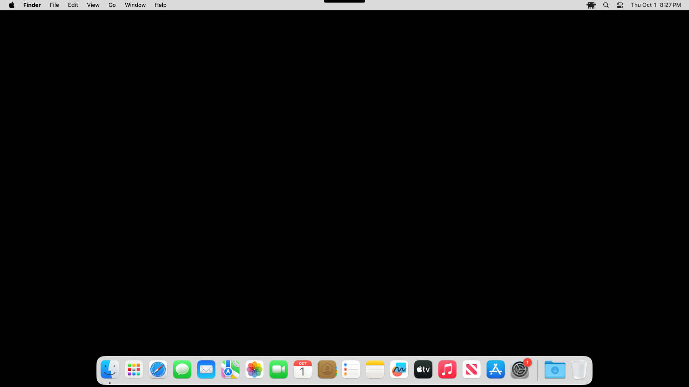
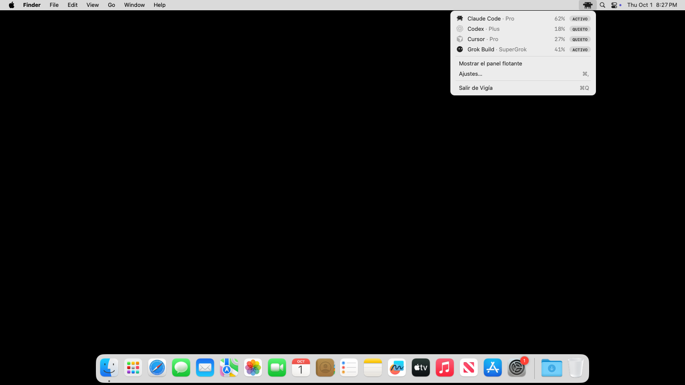
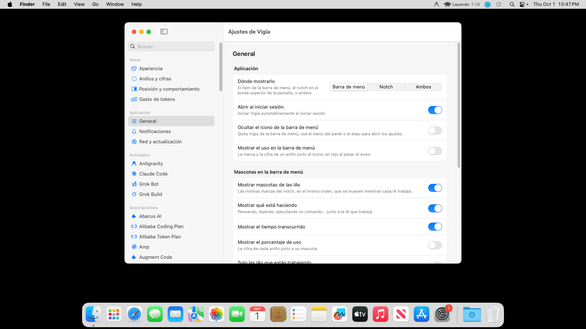

# Vigía

Vigía es una app de barra de menú para macOS. Muestra, para cada agente de IA en este Mac, si está trabajando ahora y cuánto lleva usado de sus límites. No llama a ningún modelo: lee lo que esos programas ya guardaron en el equipo.

Cubre Claude Code, Codex, Cursor, Gemini CLI y Grok Build (`~/.grok`), y el resto de proveedores que ya sabían leer los proyectos de los que sale esta app (más de setenta).

## Qué hace

- **Barra de menú.** Una mascota por cada IA de tu panel, en el mismo orden que el notch: Clawd (el cangrejo en píxeles) para Claude Code, la bolita de Grok Bot, y el logo de las demás, o su mascota animada si la activas. Se mueven solo mientras esa IA trabaja y, junto a ella, aparece qué está haciendo y cuánto lleva: *Pensando… 0:13*, *Leyendo 1:04*, *Ejecutando comando 0:07*. Mientras la IA solo espera a que acabe un comando largo —pruebas, una compilación— lo dice aparte, porque ahí no está gastando tokens: *Probando… 2:13*, *Compilando… 0:41*, *Esperando comando… 0:25* (ver «Esperando un comando»). Las que no hacen nada se quedan quietas.
- **Clic en la barra de menú.** Abre la tarjeta de detalle de cada IA, la misma que el notch muestra al dejar el puntero sobre un anillo: sus límites, cuándo se reinician y si van a alcanzar.
- **Notch.** El panel del borde de la pantalla, con los anillos de uso. Se abre al pasar el puntero o al hacer clic.
- **Ajustes de la barra de menú.** Activar o quitar las mascotas, el texto de lo que hace cada IA, el tiempo transcurrido y el porcentaje de uso; mostrar solo las IAs que están trabajando; y elegir cuáles aparecen.
- **Español o inglés.** La interfaz está completa en los dos idiomas y nunca se mezclan. «Sistema» usa español si tu Mac está en español y, en cualquier otro caso, inglés.

La apariencia clara y oscura sigue al sistema. Cada agente tiene un interruptor en Ajustes para usar el logo oficial o la mascota animada.

## Animaciones

Cada mascota muestra qué está haciendo la IA. Claude Code tiene a Clawd, y cualquier otra IA puede usar la bolita animada (mismo motor, cada una con su color y su personalidad) si activas su interruptor; las demás animan su logo. Donde Vigía puede ver las sesiones del agente (Claude Code, Codex, Cursor, Gemini CLI, Grok Build…), las poses salen de la actividad real, y lo que dice el texto de la barra de menú es lo que se ve.

| Situación | Clawd | Bolita (Grok Bot) | Logo |
| --- | --- | --- | --- |
| Ejecuta un comando, edita, escribe, planea o piensa | Teclea en una laptop | Escena de «escribir» o «trabajar» con una laptop delante | Un brillo cruza el logo |
| Busca, lee, navega o delega | Camina de prisa | Escena de «buscar», con líneas de velocidad | Tres puntos orbitan el logo |
| Espera a que acaben unas pruebas (*Probando…*) | Sostiene un tubo de ensayo que burbujea | Mira un tubo de ensayo que burbujea | El logo se aparta junto al tubo |
| Espera una compilación o un comando de más de 20 s (*Compilando…*, *Esperando comando…*) | Junto a un reloj de arena, golpeando el suelo con una pata | Mira un reloj de arena que se vacía y se da la vuelta | El logo se aparta junto al reloj |
| Acaba de terminar un turno (5 min) | Toma café, con vapor | Canturrea con una taza humeante | Vapor sube del logo |
| Quieta y despierta | Parpadea | Su rutina de siempre | Respira |
| Sin actividad (20 min) | Duerme con «Z» | Se adormila y duerme, con «z» | Atenuado, con «z» |
| Límite al 75 % o más | Cansado: párpados caídos y una gota de sudor | Cansada, con una gota de sudor | Se ladea y suda |
| Límite al 100 % | Ojos en X y estrellas mareadas | Se apaga, con estrellas mareadas | Tiembla entre estrellas |

Esperar un comando cuenta como turno en curso (no se duerme ni celebra), pero no es «trabajar»: Clawd deja la laptop. Trabajar manda sobre todo, y el descanso de después del turno también; el cansancio y el agotamiento se ven cuando no está trabajando ni de descanso.

Las IAs que no se pueden observar (Grok Bot, por ejemplo) no «trabajan»: muestran primero el cansancio y el agotamiento según su límite y, si no, van cambiando de escena a lo largo del día: duermen de noche (23:00 a 06:00), toman café por la mañana y después, cada cuarto de hora, parpadean, descansan, teclean en la laptop o salen a correr. Los logos solo descansan y toman café. Con «Reducir movimiento» activado en macOS los logos se quedan quietos. En Ajustes, Clawd puede conservar el naranja de Claude en la barra de menú.

## Esperando un comando

Cuando Claude Code lanza un comando con la herramienta Bash, Vigía mira qué comando es:

- **Pruebas** (`manage.py test`, `pytest`, `npm test`, `npm run test:e2e`, `swift test`, `npx playwright test`, `go test`, `cargo test`, `make test`…): *Probando…* desde el primer segundo.
- **Compilaciones** (`swift build`, `xcodebuild`, `npm run build`, `cargo build`, `docker build`, `make`…): *Compilando…*.
- **Cualquier otro comando** que lleve más de 20 segundos sin volver: *Esperando comando…*.

El reloj de al lado cuenta desde que empezó el comando, no el turno. Al volver el resultado (`PostToolUse`) pasa a *Pensando…*, y con `Stop` termina. Como un `manage.py test` puede tardar bastante, las pruebas y compilaciones se dan por vivas hasta 15 minutos sin noticias (el resto de herramientas, 5).

Las reglas están en `Sources/Pulse/Usage/CommandWait.swift`; atraviesan envoltorios como `timeout 900`, `uv run`, `docker compose exec web` o `cd x &&`, y no confunden `pip install pytest` o `grep pytest` con una prueba. La tabla `Tests/PulseTests/Fixtures/command-kinds.tsv` dice qué es cada comando de ejemplo, y la comprueban tanto `swift test` como `scripts/test-vigia-notify.sh` (la copia en Bash del hook). Para Claude Code en este Mac funciona solo, leyendo sus transcripciones; para otra máquina hace falta el hook de abajo.

## Actividad remota

Claude en el navegador o en la app de Mac se detecta mirando la conversación más reciente de tu cuenta (usa la sesión de la app de escritorio). Para Claude Code en otra máquina, activa **Ajustes > Barra de menú > Actividad remota de Claude Code**: Vigía escucha en el puerto 7717, protegido con un token (botón *Copiar token*), y los hooks de Claude Code del servidor le avisan con un POST a `/activity` (`UserPromptSubmit`, `PreToolUse`, `PostToolUse`, `Stop`). El cuerpo puede llevar `"provider"` (`claudeCode`, `grok` para Grok Build, `grokBot`, `codex`, …; por defecto `claudeCode`), así que sirve igual para Grok Build y las demás IAs, y desde 0.6.0 un `"kind"` opcional (`"test"` o `"build"`) en los `PreToolUse` de Bash, para *Probando…* y *Compilando…*. Un hook viejo sin `kind` sigue funcionando (solo verá *Esperando comando…* a los 20 s).

`scripts/vigia-notify.sh` es un hook listo para copiar a la otra máquina (bash 3.2 o posterior, `jq` y `curl`): lee `VIGIA_URL` y `VIGIA_TOKEN` de `~/.config/vigia/env`, clasifica el comando allí mismo y **solo envía la categoría, nunca el comando**. Regístralo en `~/.claude/settings.json` de esa máquina:

```json
{
  "hooks": {
    "UserPromptSubmit": [{ "hooks": [{ "type": "command", "command": "~/.claude/vigia-notify.sh" }] }],
    "PreToolUse":       [{ "matcher": "*", "hooks": [{ "type": "command", "command": "~/.claude/vigia-notify.sh" }] }],
    "PostToolUse":      [{ "matcher": "*", "hooks": [{ "type": "command", "command": "~/.claude/vigia-notify.sh" }] }],
    "Stop":             [{ "hooks": [{ "type": "command", "command": "~/.claude/vigia-notify.sh" }] }]
  }
}
```

**Color de la barra.** Vigía lee el fondo de pantalla bajo la barra de menú de cada pantalla (sin pedir permisos) y, si una mascota se confunde con él —Clawd naranja sobre un fondo naranja, por ejemplo—, la dibuja en blanco o negro, la que se vea en todas tus pantallas a la vez. Está apagado por defecto; úsalo solo por una red privada (Tailscale o un túnel SSH).

### Grok Bot en el box

En la máquina donde corren los bots de Grok (el "box"), `scripts/vigia-grok` es el aviso: `VIGIA_AGENT=Dobby vigia-grok UserPromptSubmit|Stop` (y `PreToolUse`/`PostToolUse` con el nombre de la herramienta) manda `{"provider":"grokBot","agent":"Dobby",...}` a Vigía. Sin `VIGIA_AGENT`, el aviso es de "Grok Bot" a secas. Varios bots a la vez se ven aparte: "Dobby trabajando", "Dobby y Neo trabajando", "3 bots trabajando", y "Dobby terminó" unos segundos tras su `Stop`.

## Capturas

El notch plegado, el notch abierto, la barra de menú con su menú, y la ventana de ajustes:

<picture>
  <source media="(prefers-color-scheme: dark)" srcset="docs/notch-collapsed-dark.png">
  
</picture>

<picture>
  <source media="(prefers-color-scheme: dark)" srcset="docs/notch-expanded-dark.png">
  
</picture>

<picture>
  <source media="(prefers-color-scheme: dark)" srcset="docs/menu-dark.png">
  
</picture>

<picture>
  <source media="(prefers-color-scheme: dark)" srcset="docs/settings-dark.png">
  
</picture>

## Instalar

Las instalaciones salen de [GitHub Releases](https://github.com/camilocristancho14/vigia/releases), no de los artefactos de Actions.

1. Abre la release, descarga `Vigia.dmg`.
2. Ábrelo y arrastra **Vigia.app** a Aplicaciones.
3. La primera vez macOS puede bloquearla porque la firma es ad hoc. Ábrela una vez y luego ve a Ajustes del Sistema > Privacidad y seguridad > «Abrir de todos modos».
4. Si sigue sin abrir: `xattr -dr com.apple.quarantine "/Applications/Vigía.app"`

El archivo dentro de la imagen se llama `Vigia.app`. Si al copiarlo el nombre quedó con tilde, el comando de arriba es el que corresponde; si quedó sin tilde, usa `"/Applications/Vigia.app"`.

También puedes descargar `Vigia.zip` y descomprimirlo. Requiere macOS 14 o posterior.

## Desarrollo

Requiere Swift 6 y macOS 14 o posterior.

```bash
swift test                     # pruebas
scripts/test-vigia-notify.sh   # reglas de comandos del hook contra la misma tabla que swift test
scripts/make-app.sh            # arma build.noindex/Vigia.app, Vigia.dmg y Vigia.zip
```

Las capturas de `docs/` salen de `scripts/capture-screenshots.sh`, que lanza la app real en modo demo (datos de ejemplo, sin red ni sesiones reales) y la CI las publica como artefacto. La rama `main` está protegida: los cambios entran por Pull Request.

## Créditos

Vigía reutiliza el código y el diseño visual de tres proyectos:

- [Pulse](https://github.com/qunqin24/Pulse) de qunqin24 — Apache-2.0. El panel del notch, los anillos y los lectores de uso. Licencia en `LICENSES/Pulse-Apache-2.0.txt`.
- [codenotch](https://github.com/vinzdg/codenotch) de Vinz — MIT. La actividad local de Grok Build, Cursor y Gemini CLI. Licencia en `LICENSES/codenotch-MIT.txt`.
- [claude-status-bar](https://github.com/m1ckc3s/claude-status-bar) de Mick Cesanek — MIT. El ítem de la barra de menú y Clawd. Licencia en `LICENSES/claude-status-bar-MIT.txt`.

Los avisos completos están en `THIRD_PARTY_NOTICES.md`. Las marcas de los proveedores vienen de [Lobe Icons](https://github.com/lobehub/lobe-icons). La bola animada de los anillos parte de [grokbot-animation](https://github.com/iduu/grokbot-animation).
